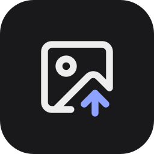

<div align="center">


# kshanx's App

**A community app store for [umbrelOS](https://umbrel.com), by [kshanxs](https://github.com/kshanxs).**
Apps that aren't in the official Umbrel App Store, packaged to install and update with one click.

[](https://github.com/kshanxs/kshanxs-umbrel-store/actions/workflows/check.yml)
[](https://github.com/kshanxs/kshanxs-umbrel-store/actions/workflows/update-apps.yml)


[](LICENSE)

</div>

---

## Add the store to your Umbrel

1. Open the **App Store** on your Umbrel.
2. Click **⋯** in the top-right corner and choose **Community App Stores**.
3. Paste this URL and click **Add**:

   ```
   https://github.com/kshanxs/kshanxs-umbrel-store
   ```

4. Open **kshanx's App** and install what you like.

> [!NOTE]
> Community apps are not reviewed by Umbrel. Read what an app does before you install it.

## Apps

<table>
  <tr>
    <td width="80" align="center">
      
    </td>
    <td>
      <b><a href="kshan-9router">9Router</a></b> &nbsp; <br>
      Free AI router with automatic fallback across providers. One OpenAI-compatible
      endpoint for OpenRouter, Gemini, Groq, Kiro, OpenCode Free and 40+ more.<br>
      <sub>Upstream: <a href="https://github.com/decolua/9router">decolua/9router</a></sub>
    </td>
  </tr>
  <tr>
    <td width="80" align="center">
      
    </td>
    <td>
      <b><a href="kshan-cliproxyapi">CLIProxyAPI</a></b> &nbsp; <br>
      Home hub for your AI subscriptions. Sign Antigravity, Gemini CLI, Codex or Claude Code in once,
      then use them from every device over Tailscale.<br>
      <sub>Upstream: <a href="https://github.com/router-for-me/CLIProxyAPI">router-for-me/CLIProxyAPI</a></sub>
    </td>
  </tr>
  <tr>
    <td width="80" align="center">
      
    </td>
    <td>
      <b><a href="kshan-gphotos-sync">GP Sync</a></b> &nbsp; <br>
      Copies every photo and video in your Umbrel Photos and Videos folders to Google Photos,
      in original quality. Nothing on Umbrel is changed.<br>
      <sub>By kshanxs: <a href="https://github.com/kshanxs/gp-sync">kshanxs/gp-sync</a> · uploads with <a href="https://github.com/xob0t/google_photos_mobile_client">gpmc</a> by xob0t</sub>
    </td>
  </tr>
</table>

## Updates

- **Every hour**, a GitHub Action checks each app's upstream image (Docker Hub or ghcr.io). When
  there is a new release, it updates the app's version, image (pinned by digest) and release notes
  here by itself. GP Sync's notes come from its `CHANGELOG.md`.
- **Every 5 minutes**, your Umbrel checks this store. A new version shows up as an **Update** button on the app.
- **You** click Update. umbrelOS does not install app updates by itself.

## Repository layout

```
umbrel-app-store.yml        store id (kshan) and name
<app-id>/
  umbrel-app.yml            name, version, description, port, icon, gallery
  docker-compose.yml        containers, with images pinned by digest
  hooks/                    optional scripts Umbrel runs (pre-install, pre-start, ...)
  update.yml                optional: upstream image to follow (Docker Hub or ghcr.io)
  icon.svg, gallery/        images shown in the App Store
```

## Adding an app

1. Create a folder named `kshan-<app>`. Every app id must start with the store id `kshan-`.
2. Add `umbrel-app.yml` and `docker-compose.yml`. Use the existing app as a template, and pick a `port` no other app uses.
3. Pin every image with its digest: `image: owner/name:1.2.3@sha256:...`.
4. Add `update.yml` with the image name if you want automatic version bumps.
5. Push. The **Check store** action validates the folder.

## Credits

kshanx's App is made and maintained by **[kshanxs](https://github.com/kshanxs)**. The store files
(manifests, compose files, scripts and README) are [MIT licensed](LICENSE), © 2026 kshanxs.

| App | Made by | License |
|---|---|---|
| GP Sync | [kshanxs](https://github.com/kshanxs/gp-sync), using [gpmc](https://github.com/xob0t/google_photos_mobile_client) by xob0t | MIT |
| 9Router | [decolua](https://github.com/decolua/9router) | see upstream |
| CLIProxyAPI | [router-for-me](https://github.com/router-for-me/CLIProxyAPI) | see upstream |

Each app belongs to its own authors and keeps its own license. Icons and screenshots in an app's
folder come from that app's project. Packaging for Umbrel by kshanxs.

See [CHANGELOG.md](CHANGELOG.md) for store releases.
