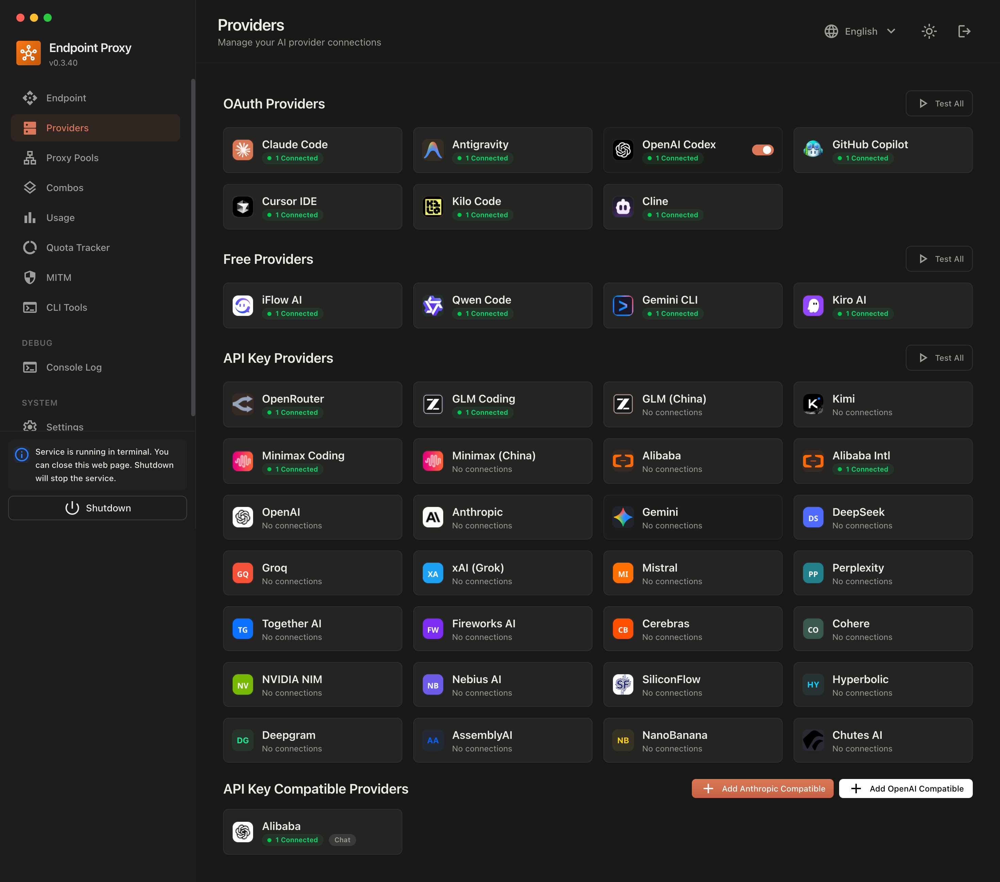

# 9Router for Umbrel

[9Router](https://github.com/decolua/9router) is an OpenAI-compatible AI gateway. Connect your AI providers once, group models into **combos**, and every app on your Umbrel can use one endpoint that falls back to the next model when one runs out.

## Using it

1. Install **9Router** from kshanx's App.
2. Open it. Umbrel shows the dashboard password first. Copy it, then log in.
3. Go to **Providers** and connect what you have, for example an OpenRouter or Gemini key, Kiro, or OpenCode Free (no account needed).
4. Under **Combos**, make an ordered list of models, for example `free`.
5. Under **Endpoint**, create an API key for each app that will use 9Router.

## Connecting other Umbrel apps

From another app's container, use:

| Setting | Value |
| --- | --- |
| Base URL | `http://kshan-9router_web_1:20128/v1` |
| API key | a key from the dashboard |
| Model | a combo name (like `free`) or a model such as `openrouter/...` |

API requests on `/v1/*` skip the Umbrel login and always need an API key.

## Details

| | |
| --- | --- |
| Image | `decolua/9router`, pinned by digest |
| Data | `~/umbrel/app-data/kshan-9router/data/9router` |
| Secrets | `~/umbrel/app-data/kshan-9router/data/app.env`, created on first start |
| Password | generated by Umbrel, shown when you open the app |
| Updates | bumped daily by the [Update apps](../.github/workflows/update-apps.yml) action |
