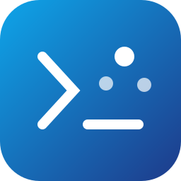

# CLIProxyAPI for Umbrel

[CLIProxyAPI](https://github.com/router-for-me/CLIProxyAPI) turns your Umbrel into a home hub for your AI subscriptions. Sign your accounts in once here, and every coding tool on your other machines uses them through one endpoint over Tailscale. All provider traffic leaves from your home IP, and logins stay fresh in one place.

> [!WARNING]
> Using subscriptions through a proxy may break a provider's terms, and accounts can be restricted. A hub lowers the risk, it does not remove it. Use it for your own coding tools only: never resell it or serve other people's traffic, and use Claude subscriptions only in Claude Code.

## Set up

1. Install **CLIProxyAPI** from kshanx's App and open it. Umbrel shows the **management key** first. Copy it and log in to the panel with it.
2. **Add an account.** Go to **OAuth Login**, pick a provider (for example **Antigravity**), and open the link it gives you. After you sign in, your browser lands on a `localhost` page that doesn't load. That's expected: copy the whole address from the address bar and paste it back into the panel.
3. **Copy your API key.** It's under **Config → API keys** (or `access.api-keys` in `~/umbrel/app-data/kshan-cliproxyapi/data/config.yaml`).
4. **Expose it on your tailnet.** On the Umbrel, run once:

   ```bash
   sudo docker exec tailscale_web_1 tailscale serve --bg --https=8318 http://127.0.0.1:8317
   ```

   The hub is now at `https://<umbrel>.<tailnet>.ts.net:8318`. Only devices on your tailnet can reach it.
   Use 8318, not 8317: Umbrel already serves the app itself on 8317, and taking that port on the Tailscale address stops the app from opening over Tailscale.

## Point your tools at it

**Claude Code**, in `~/.claude/settings.json`:

```json
{
  "env": {
    "ANTHROPIC_BASE_URL": "https://<umbrel>.<tailnet>.ts.net:8318",
    "ANTHROPIC_AUTH_TOKEN": "<your API key>"
  }
}
```

**Codex**, in `~/.codex/config.toml`:

```toml
model_provider = "cliproxy"

[model_providers.cliproxy]
name = "CLIProxyAPI"
base_url = "https://<umbrel>.<tailnet>.ts.net:8318/v1"
wire_api = "responses"
requires_openai_auth = false
supports_websockets = true
experimental_bearer_token = "<your API key>"
```

**Anything OpenAI-compatible**: base URL `https://<umbrel>.<tailnet>.ts.net:8318/v1`, your API key, and a model from `/v1/models`.

To keep your normal setup untouched, use a second config folder: `CLAUDE_CONFIG_DIR=~/.claude-hub claude` or `CODEX_HOME=~/.codex-hub codex`.

## Keeping your account safe

Nothing makes this ban-proof, but these keep your traffic looking like one person using their own subscription:

- **One home IP.** Only the hub talks to providers. Never sign the same account in on a VPS, a VPN, or a second hub.
- **People, not robots.** Keep 24/7 automated jobs (heartbeats, cron tasks) on free or API-key models, not on subscription logins.
- **Back off on limits.** The default config retries a failed request only once and puts an account on cooldown after a rate-limit error, remembered across restarts.
- **Stay on one account per conversation.** Session affinity is on, so a thread doesn't hop between accounts.
- **Own use only.** Don't share the API key or serve other people's traffic, and use Claude subscriptions only in Claude Code.

## Details

| | |
| --- | --- |
| Image | `eceasy/cli-proxy-api`, pinned by digest |
| Config | `~/umbrel/app-data/kshan-cliproxyapi/data/config.yaml`, created on first start with a random API key |
| Logins | `~/umbrel/app-data/kshan-cliproxyapi/data/auths`. To bench an account, set `"disabled": true` in its file |
| Panel | `/management.html` behind your Umbrel login; API paths `/v1/*` need an API key |
| Routing | round-robin with session affinity on, so a conversation stays on one account |
| Updates | bumped daily by the [Update apps](../.github/workflows/update-apps.yml) action |

Setup follows Theo's [CLIProxyAPI hub guide](https://gist.github.com/t3dotgg/59a521d2ee8d70aaf90e280c175072af).
